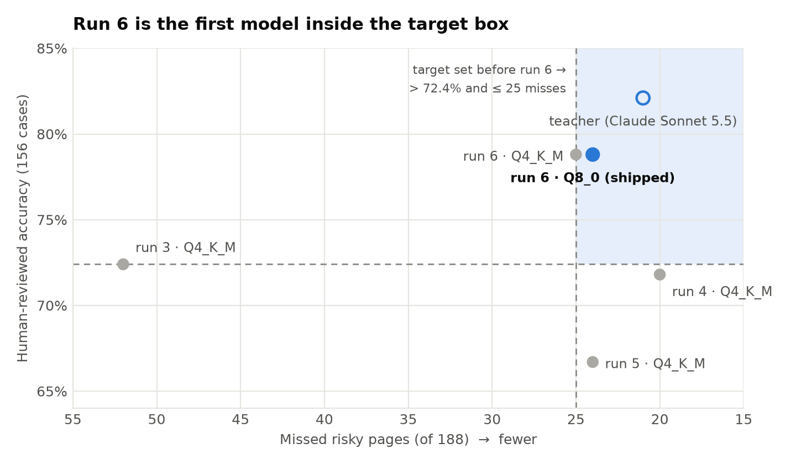
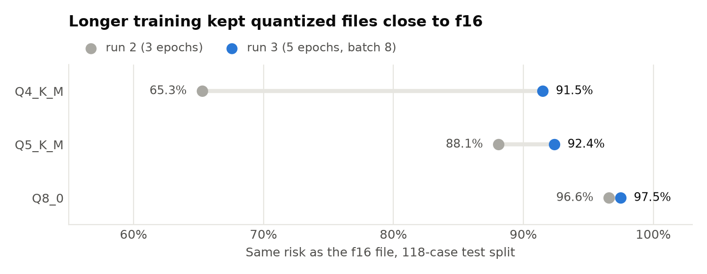

# guadian-ondevice


<picture>
  <source media="(prefers-color-scheme: dark)" srcset="docs/assets/runs-dark.png">
  
</picture>

「guadian」 is a service for seniors that prevents digital harm originating from malicious advertisements, developed in the SKT FLY AI bootcamp. This repository implements the **judgment** stage of its detect → judge → intervene pipeline on the device rather than on a server: a [Qwen3-1.7B](ml/docs/llm/model-card.md) model fine-tuned with LoRA and executed with llama.cpp as a 1.83 GB Q8_0 file reads the content of a landing page and answers six factual questions. A [verdict table](docs/design.md) shared by the app and the ML code then maps those answers to a risk level. No URL or page content leaves the device at any stage. The current model achieves **78.8%** accuracy on 156 human-reviewed cases, with **24 false negatives** out of 188 risky pages (12.8%). See the [Technical Report](docs/technical-report.md) for the full development history.

## How a URL is judged

The Android app executes a staged pipeline. Each stage contributes evidence; the verdict table terminates early once the evidence is sufficient. Unresolved pages are forwarded to the page inspector and, in the manual flow, to the on-device LLM.

```text
URL
  -> Cache & URL
  -> Page inspection
  -> On-device LLM
  -> Verdict table
  -> risk
```

> [!NOTE]
> The model does not assign the risk level. It answers `claims`, `sign_in`, `payment`, `investment`, `reward_pressure` and `content_farm`, and [`verdict_table.json`](ml/runtime/verdict_table.json) determines the risk. A policy change therefore requires only an edit to that table, not relabeling and retraining.

The app provides two entry points:

| Entry point | Role |
| :-- | :-- |
| [`JudgeActivity`](app/src/main/kotlin/com/guadian/ondevice/ui/JudgeActivity.kt) | manual URL judgment for development and evaluation |
| [`ShieldAccessibilityService`](app/src/main/kotlin/com/guadian/ondevice/shield/ShieldAccessibilityService.kt) | detects browser link clicks via Android accessibility APIs |

Verdicts reached with sufficient confidence are cached in memory, keyed by the normalized URL and the verdict table version. Each stage is described in [Architecture](docs/architecture.md).

## Training runs

The design was refined over six training runs. Run 6 introduced the key change: instead of classifying risk directly, the model answers factual questions and a shared table determines the verdict.

| Run | Change | Result | Decision |
| :-- | :-- | :-- | :-- |
| 1 | QLoRA on a 4-bit base, merged into fp16 for GGUF export | Accuracy degraded after merging and export | Train on the fp16 base used for export |
| 2 | LoRA on the fp16 base, 3 epochs | Output format stabilized; Q4_K_M agreement with f16 only 65.3% | Improve quantization robustness |
| 3 | 5 epochs, effective batch 8, repeated `HIGH` cases | Q4_K_M reached 74.6% on the 118-case split | First app-integrated model |
| 4 | 2,094-case dataset, `HIGH` cases repeated 3× | False negatives decreased substantially; false positives increased | Not adopted |
| 5 | Run 4 settings with aligned training labels | False positives decreased; false negatives increased again | Not adopted |
| **6** | **Six-question model + verdict table** | **78.8% human-reviewed accuracy; 24 of 188 false negatives** | **Current model** |

Runs 4 and 5 demonstrated that aggregate accuracy alone is insufficient for model selection. False negatives, false positives on benign pages, quantization stability and label alignment must each be measured separately. The chart above compares runs 3 to 6 on the relabeled 414-case split; runs 1 and 2 were evaluated on an earlier split and are therefore omitted. Accuracy in the chart is measured on the 156 human-reviewed cases, and false negatives on all 188 risky cases.

Run 3 resolved the quantization degradation observed in run 2:

<picture>
  <source media="(prefers-color-scheme: dark)" srcset="docs/assets/quant-dark.png">
  
</picture>

## Current model

Run 6 is deployed as **Q8_0** (1.83 GB) rather than Q4_K_M due to the latter's lower recall on impersonation evidence (`claims` recall: 68.9% vs. 80.0%). Q8_0 incurs a 1.03–1.18× per-verdict latency overhead relative to Q4_K_M (arm64 emulator).

| Metric | Run 6 Q8_0 |
| :-- | --: |
| Test accuracy | 92.0% of 414 cases |
| Human-reviewed accuracy | 78.8% of 156 cases |
| False negatives | 24 of 188 risky cases |
| OpenPhish pages classified `LOW` | 11 of 43 opened pages |
| False positives (Tranco top sites) | 2 of 62 opened sites |
| Teacher-answer exact match | 92.3% |
| `claims` recall | 80.0% |

The data is split by site, so no test site appears in the training set. Sources include the original guadian landing URLs, OpenPhish, Korean Tranco sites and Naver search results ([LLM Dataset](ml/docs/llm/dataset.md)). Every score can be regenerated from the committed records in the [LLM Evaluation Report](ml/reports/llm/evaluation-report.md).

## Getting started

1. **Build and test the app.** llama.cpp is fetched at build time from a pinned, SHA256-verified release.

   ```bash
   ./gradlew test && ./gradlew :app:installDebug
   ```

2. **Add the model.** The GGUF file is neither bundled nor distributed ([Provenance](docs/provenance.md)). If the model file is absent, the LLM stage reports "not loaded" and the verdict defaults to `UNKNOWN`.

   <details>
   <summary>Copy <code>guadian-qwen3-1.7b-run6-Q8_0.gguf</code> into the app's private storage</summary>

   ```bash
   adb push guadian-qwen3-1.7b-run6-Q8_0.gguf /data/local/tmp/guadian.gguf
   adb shell run-as com.guadian.ondevice sh -c 'mkdir -p files/models && cp /data/local/tmp/guadian.gguf files/models/guadian.gguf'
   adb shell rm /data/local/tmp/guadian.gguf
   ```

   </details>

3. **Set up the ML workspace** (Python 3.11+) with `pip install -e "ml[llm]"`. Data, training and evaluation commands are documented in the [ML workspace README](ml/README.md). The charts above are generated by [`scripts/make_readme_charts.py`](scripts/make_readme_charts.py).

## File structure

| Path | Contents |
| :-- | :-- |
| [`app/`](app/) | Android app, UI and the Shield accessibility service |
| [`core/`](core/) | `judge` verdict pipeline · `pagecontent` WebView inspection · `llm` prompt and answers · `llamacpp` runtime |
| [`ml/`](ml/) | data, training notebook, evaluation records, and the runtime files the app loads |
| [`reference/`](reference/) | original guadian reference material |

## Limitations

This repository is a research baseline and has not been validated for production use.

- Latency and memory usage have been measured only on an arm64 emulator, not on physical devices.
- 11 of 43 opened OpenPhish pages are still classified `LOW`.
- The final label review focused on run 6's disagreements, introducing a selection bias in favor of run 6 when compared with earlier runs.
- All human-reviewed labels were reviewed by a single annotator (the project owner); inter-annotator agreement has not been measured.
- Shield's coverage is currently limited to browser link clicks. In-app WebViews, native ad surfaces, model packaging and broader real-world validation remain open.

## More

[Technical Report](docs/technical-report.md) · [Evaluation Report](ml/reports/llm/evaluation-report.md) · [Model Card](ml/docs/llm/model-card.md) · [Dataset](ml/docs/llm/dataset.md) · [Verdict Design](docs/design.md) · [Architecture](docs/architecture.md) · [Provenance](docs/provenance.md)
